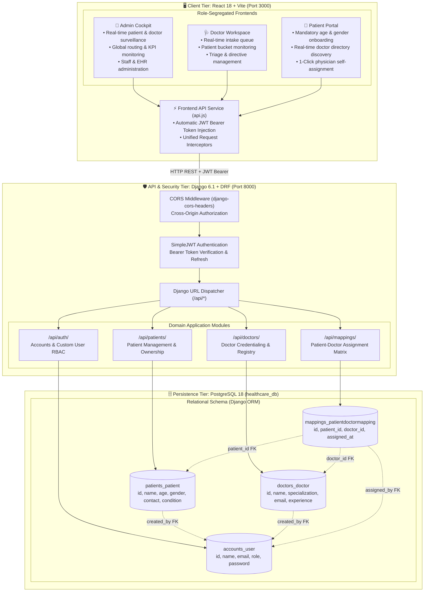
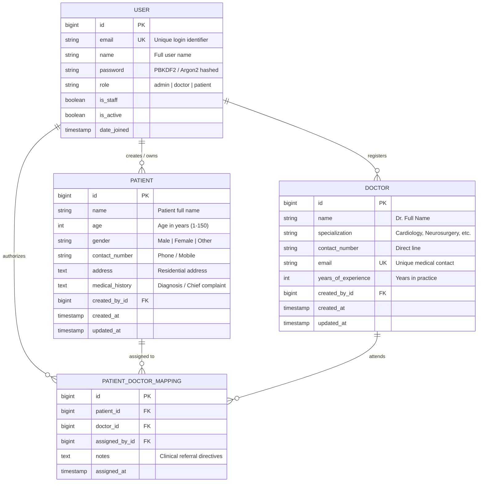

# Veritas Clinical Systems · Full-Stack Healthcare Platform

A production-grade, full-stack healthcare application with role-segregated workflows built with **Django REST Framework (DRF)**, **PostgreSQL 18**, **SimpleJWT Authentication**, and a high-performance **React 18** clinical user interface.

---

## 🏛️ System Architecture Diagram



---

## 🧬 Database Entity-Relationship (ER) Diagram



> **Integrity Rule**: `PATIENT_DOCTOR_MAPPING` enforces a database-level unique compound constraint on `(patient_id, doctor_id)` to prevent redundant doctor assignments.

---

## ⚡ Role-Segregated Experience & Workflows

### 1. 👑 Hospital Admin Workflow (`role: admin`)
- **Real-Time Global Surveillance**: Monitors active patient count, doctors on duty, and care mapping load.
- **Administrative CRUD Controls**:
  - Full management of all patients across the hospital.
  - Ability to credential new doctors and retire faculty.
  - Manual routing matrix to assign or reassign doctors to patients.
- **Pre-configured Account**: `admin@hospital.com` / `AdminPass123!`

### 2. 🩺 Doctor Workspace & In-Basket (`role: doctor`)
- **Live Patient Bucket**:
  - Filters incoming patients specifically assigned to this doctor (`GET /api/mappings/?doctor_id=<id>`).
  - Displays patient demographics, age, gender, contact, and clinical history.
  - Displays clinical referral directives and admission timestamp.
- **Patient Discharge**: Doctor can discharge/remove a patient from their active bucket with one click.
- **Pre-configured Account**: `dr.sarah@hospital.com` / `DoctorPass123!`

### 3. 👤 Patient Discovery Portal (`role: patient`)
- **Strict Onboarding**: Asks for mandatory patient demographic information on registration:
  - Age (validated integer)
  - Gender (`Male` / `Female` / `Other`)
  - Contact Number
  - Primary Condition / Chief Complaint
- **Attending Care Team**: Starts with **0 assigned doctors** upon initial registration.
- **Physician Directory**:
  - Browse verified faculty doctors by specialization (*Cardiology, Neurosurgery, Oncology, Surgery*).
  - Review years of clinical experience and credentials.
  - Click **"PICK THIS DOCTOR"**: Automatically persists the assignment to PostgreSQL and routes the patient directly into that doctor's live bucket.
- **Pre-configured Account**: `patient.eleanor@hospital.com` / `PatientPass123!`

---

## 🚀 How to Run the Application

### Option A: Launch Both Services with 1 Command
```bash
cd "/home/arsh/Desktop/Whatbytes assessment"
./run_fullstack.sh
```
- **React Frontend**: `http://localhost:3000`
- **Django REST Framework API**: `http://127.0.0.1:8000`

---

### Option B: Run in Separate Terminals

#### **Terminal 1: Start Django + PostgreSQL Backend**
```bash
cd "/home/arsh/Desktop/Whatbytes assessment"
source venv/bin/activate
python manage.py runserver 127.0.0.1:8000
```

#### **Terminal 2: Start React Frontend**
```bash
cd "/home/arsh/Desktop/Whatbytes assessment/frontend"
npm run dev
```

---

## 🧪 Automated Test Suite (27 Tests)

The system includes 27 comprehensive unit and integration tests executing against PostgreSQL:
```bash
source venv/bin/activate
python manage.py test
```

### Coverage:
- **Authentication**: Registration, duplicate email rejection, min-length password validation, JWT token issuance.
- **Patients**: Unauthenticated access prevention (401), user-scoped patient listing, detail retrieval, updates, deletions.
- **Doctors**: Credentialing, uniqueness of doctor emails, specialty filtering, record deletion.
- **Mappings**: Assignment creation, duplicate doctor assignment prevention, doctor's patient bucket retrieval, mapping deletion.

---

## 📖 API Endpoints Reference

All secured endpoints require the JWT token in the `Authorization` header:
```http
Authorization: Bearer <access_token>
```

### 1. Authentication Endpoints (`/api/auth/`)
| Method | Endpoint | Description | Auth Required |
|---|---|---|---|
| `POST` | `/api/auth/register/` | Register new user with name, email, password, and role | No |
| `POST` | `/api/auth/login/` | Log in with email and password; returns JWT access & refresh tokens | No |
| `POST` | `/api/auth/token/refresh/` | Refresh an expired access token using refresh token | No |

### 2. Patient Management Endpoints (`/api/patients/`)
| Method | Endpoint | Description | Auth Required |
|---|---|---|---|
| `POST` | `/api/patients/` | Add a new patient record (auto-assigns `created_by=request.user`) | Yes |
| `GET` | `/api/patients/` | Retrieve all patients created by the authenticated user | Yes |
| `GET` | `/api/patients/?all=true`| Retrieve all hospital patients (Admin surveillance) | Yes (Admin) |
| `GET` | `/api/patients/<id>/` | Get details of a specific patient | Yes |
| `PUT` | `/api/patients/<id>/` | Full update of a patient record | Yes |
| `PATCH`| `/api/patients/<id>/` | Partial update of a patient record | Yes |
| `DELETE`| `/api/patients/<id>/`| Delete a patient record from PostgreSQL | Yes |

### 3. Doctor Management Endpoints (`/api/doctors/`)
| Method | Endpoint | Description | Auth Required |
|---|---|---|---|
| `POST` | `/api/doctors/` | Add a new doctor to the faculty registry | Yes |
| `GET` | `/api/doctors/` | Retrieve all registered doctors | Yes |
| `GET` | `/api/doctors/<id>/` | Get details of a specific doctor | Yes |
| `PUT` | `/api/doctors/<id>/` | Full update of doctor information | Yes |
| `PATCH`| `/api/doctors/<id>/` | Partial update of doctor information | Yes |
| `DELETE`| `/api/doctors/<id>/`| Delete a doctor record | Yes |

### 4. Patient-Doctor Mapping Endpoints (`/api/mappings/`)
| Method | Endpoint | Description | Auth Required |
|---|---|---|---|
| `POST` | `/api/mappings/` | Assign a doctor to a patient (prevents duplicate mappings) | Yes |
| `GET` | `/api/mappings/` | Retrieve all patient-doctor mappings | Yes |
| `GET` | `/api/mappings/?doctor_id=<id>`| Retrieve all patients in a specific doctor's bucket | Yes |
| `GET` | `/api/mappings/<patient_id>/` | Get all doctors assigned to a specific patient | Yes |
| `DELETE`| `/api/mappings/<id>/`| Remove a doctor from a patient (deletes mapping) | Yes |

---

## 📂 Project Directory Structure

```text
Whatbytes assessment/
├── accounts/                  # User model, registration, login & JWT views
│   ├── models.py              # Custom User model (email as primary identifier + role)
│   ├── serializers.py         # Register, Login & User serializers with role support
│   ├── views.py               # RegisterView, LoginView
│   ├── urls.py                # /api/auth/ routes
│   └── tests.py               # Auth test cases
├── patients/                  # Patient management app
│   ├── models.py              # Patient model (name, age, gender, contact, condition)
│   ├── serializers.py         # PatientSerializer with field validators
│   ├── views.py               # PatientListCreateView and PatientDetailView
│   ├── urls.py                # /api/patients/ routes
│   └── tests.py               # Patient CRUD test suite
├── doctors/                   # Doctor management app
│   ├── models.py              # Doctor model (specialty, years_of_experience, email)
│   ├── serializers.py         # DoctorSerializer with email uniqueness check
│   ├── views.py               # DoctorListCreateView and DoctorDetailView
│   ├── urls.py                # /api/doctors/ routes
│   └── tests.py               # Doctor CRUD test suite
├── mappings/                  # Patient-Doctor mapping app
│   ├── models.py              # PatientDoctorMapping with unique_together constraint
│   ├── serializers.py         # Mapping serializers with nested relations
│   ├── views.py               # MappingListCreateView (?doctor_id=) & MappingDetailView
│   ├── urls.py                # /api/mappings/ routes
│   └── tests.py               # Mapping test suite
├── healthcare_backend/        # Project settings & root routing
│   ├── settings.py            # DRF, SimpleJWT, PostgreSQL, CORS & environment settings
│   ├── urls.py                # Root router & API index documentation
│   └── exceptions.py          # Standardized JSON error response handler
├── frontend/                  # React 18 + Vite frontend
│   ├── src/
│   │   ├── services/api.js    # API service client with JWT token injection
│   │   ├── App.jsx            # Multi-role UI (Admin, Doctor Bucket, Patient Discovery)
│   │   ├── index.css          # Editorial styling, grain overlay, and animations
│   │   └── main.jsx           # React DOM root entrypoint
│   └── package.json           # Frontend dependencies
├── backend-mongodb/           # Alternative MongoDB + Express + Mongoose backend
├── Healthcare_Backend_Postman_Collection.json # Ready-to-import Postman suite
├── run_fullstack.sh           # 1-command startup script
├── .env                       # Environment configuration
├── .env.example               # Template for environment configuration
├── requirements.txt           # Python package requirements
└── README.md                  # Detailed architectural documentation
```
