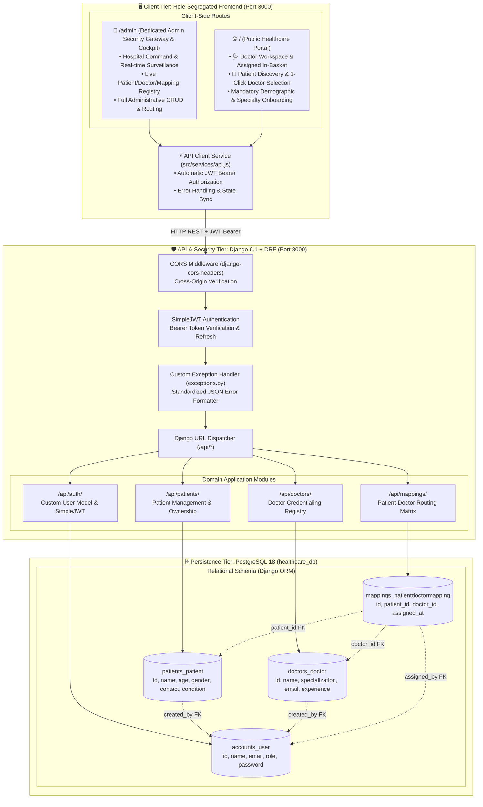
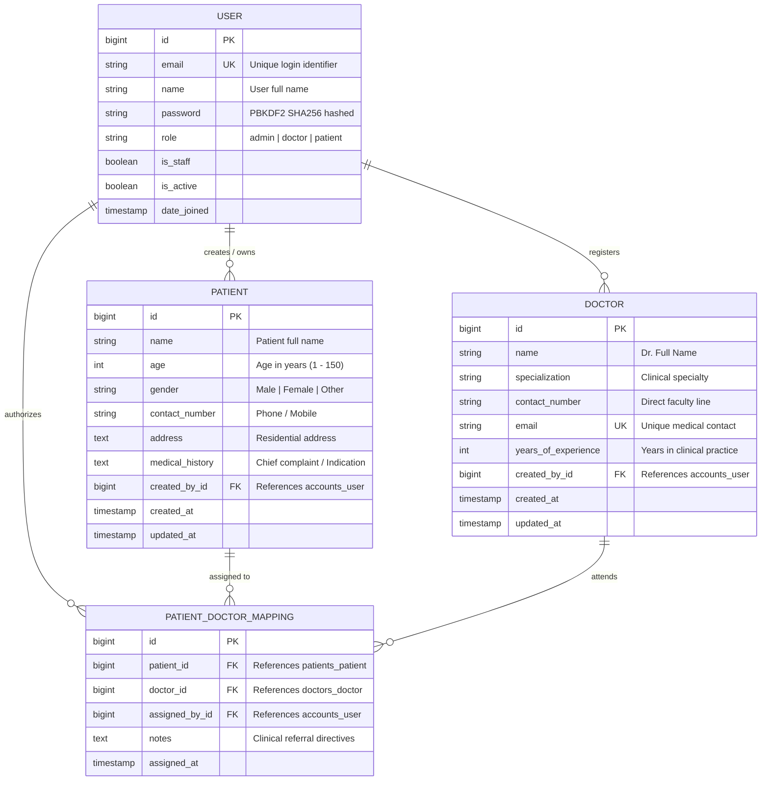

# Django Assignment: Building a Healthcare Backend
### Production-Ready Healthcare Platform · Django REST Framework · PostgreSQL · SimpleJWT

[](https://www.djangoproject.com/)
[](https://www.django-rest-framework.org/)
[](https://www.postgresql.org/)
[](https://django-rest-framework-simplejwt.readthedocs.io/)
[](https://react.dev/)
[](https://github.com)

---

## 📌 Assignment Objective & Requirements Compliance

The objective of this assignment is to develop a secure, robust backend system for a healthcare application using **Django**, **Django REST Framework (DRF)**, and **PostgreSQL**. The system enables users to register, log in, and manage patient and doctor records securely, along with patient-doctor care mappings.

### Requirements Compliance Matrix

| Requirement | Implementation Detail | Status |
| :--- | :--- | :---: |
| **Django & DRF** | Built using Django 6.1 and Django REST Framework 3.18 with modular app separation (`accounts`, `patients`, `doctors`, `mappings`). | ✅ Complete |
| **PostgreSQL Database** | Configured with `psycopg2-binary` pointing to PostgreSQL 18 with relational integrity and ACID transactions. | ✅ Complete |
| **JWT Authentication** | Implemented using `djangorestframework-simplejwt` with Bearer token authorization and access/refresh lifecycle. | ✅ Complete |
| **RESTful API Endpoints** | Full CRUD implemented for Patients, Doctors, and Patient-Doctor Mappings following REST standards. | ✅ Complete |
| **Django ORM Modeling** | Normalized relational models with custom User model, ForeignKeys, unique constraints, and validation. | ✅ Complete |
| **Error Handling & Validation** | Custom exception handler (`exceptions.py`), field-level validators, HTTP 400/401/403/404/500 JSON error responses. | ✅ Complete |
| **Environment Variables** | Sensitive keys, database credentials, and debug flags isolated in `.env` managed via `python-dotenv`. | ✅ Complete |
| **Role-Segregated Frontend** | React 18 editorial UI with separate `/admin` cockpit, doctor in-basket, and patient self-assignment workflows. | ✅ Complete |
| **Automated Testing** | 27 passing test cases verifying authentication, ownership permissions, constraints, and CRUD operations. | ✅ Complete |
| **Postman Collection** | Pre-configured `Healthcare_Backend_Postman_Collection.json` ready for 1-click import and testing. | ✅ Complete |

---

## 🏛️ System Architecture Diagram



---

## 🧬 Database Entity-Relationship (ER) Diagram



> **Data Integrity Enforcement**:
> - `accounts_user.email`: Unique constraint prevents duplicate registrations.
> - `doctors_doctor.email`: Unique constraint prevents duplicate doctor listings.
> - `mappings_patientdoctormapping`: Enforces a **compound unique constraint** on `(patient_id, doctor_id)` at the database level to prevent duplicate assignments of the same patient to the same doctor.

---

## 📋 Comprehensive API Endpoints Specification

All secured endpoints require the JWT token in the `Authorization` header:
```http
Authorization: Bearer <access_token>
```

### 1. Authentication APIs (`/api/auth/`)

| Method | Endpoint | Description | Auth Required | Request Payload | Response |
| :--- | :--- | :--- | :---: | :--- | :--- |
| `POST` | `/api/auth/register/` | Register a new user with name, email, password, and role | No | `{"name": "...", "email": "...", "password": "...", "role": "patient"}` | `201 Created` + User profile |
| `POST` | `/api/auth/login/` | Log in user and return JWT access & refresh tokens | No | `{"email": "...", "password": "..."}` | `200 OK` + `tokens`, `user` |
| `POST` | `/api/auth/token/refresh/` | Obtain a fresh access token using refresh token | No | `{"refresh": "..."}` | `200 OK` + `access` |

#### `POST /api/auth/register/`
```json
// Request Body:
{
  "name": "Eleanor Vance",
  "email": "patient.eleanor@hospital.com",
  "password": "PatientPass123!",
  "role": "patient"
}

// Response (201 Created):
{
  "status": "success",
  "message": "User registered successfully.",
  "data": {
    "id": 4,
    "name": "Eleanor Vance",
    "email": "patient.eleanor@hospital.com",
    "role": "patient"
  }
}
```

#### `POST /api/auth/login/`
```json
// Request Body:
{
  "email": "admin@hospital.com",
  "password": "AdminPass123!"
}

// Response (200 OK):
{
  "status": "success",
  "message": "Login successful.",
  "tokens": {
    "refresh": "eyJhbGciOiJIUzI1NiIsIn...",
    "access": "eyJhbGciOiJIUzI1NiIsIn..."
  },
  "user": {
    "id": 1,
    "name": "Chief Admin Dr. Alex Morgan",
    "email": "admin@hospital.com",
    "role": "admin"
  }
}
```

---

### 2. Patient Management APIs (`/api/patients/`)

| Method | Endpoint | Description | Auth Required | Query Params |
| :--- | :--- | :--- | :---: | :--- |
| `POST` | `/api/patients/` | Add a new patient record (auto-binds `created_by=request.user`) | Yes | None |
| `GET` | `/api/patients/` | Retrieve all patients created by the authenticated user | Yes | None |
| `GET` | `/api/patients/?all=true` | Retrieve all hospital patients (Admin surveillance) | Yes (Admin) | `all=true` |
| `GET` | `/api/patients/<id>/` | Get detailed record of a specific patient | Yes | None |
| `PUT` | `/api/patients/<id>/` | Full update of patient details | Yes | None |
| `PATCH`| `/api/patients/<id>/` | Partial update of patient details | Yes | None |
| `DELETE`| `/api/patients/<id>/` | Delete a patient record from PostgreSQL | Yes | None |

#### `POST /api/patients/`
```json
// Request Body:
{
  "name": "Eleanor Vance",
  "age": 48,
  "gender": "Female",
  "contact_number": "+1-555-0199",
  "address": "42 Hawthorne Blvd, Seattle, WA",
  "medical_history": "Cardiac Monitoring, Arrhythmia"
}

// Response (201 Created):
{
  "status": "success",
  "message": "Patient created successfully.",
  "data": {
    "id": 1,
    "name": "Eleanor Vance",
    "age": 48,
    "gender": "Female",
    "contact_number": "+1-555-0199",
    "address": "42 Hawthorne Blvd, Seattle, WA",
    "medical_history": "Cardiac Monitoring, Arrhythmia",
    "created_by": {
      "id": 4,
      "name": "Eleanor Vance",
      "email": "patient.eleanor@hospital.com",
      "role": "patient"
    },
    "created_at": "2026-10-28T18:25:00Z",
    "updated_at": "2026-10-28T18:25:00Z"
  }
}
```

---

### 3. Doctor Management APIs (`/api/doctors/`)

| Method | Endpoint | Description | Auth Required | Query Params |
| :--- | :--- | :--- | :---: | :--- |
| `POST` | `/api/doctors/` | Add a new doctor to the faculty registry | Yes | None |
| `GET` | `/api/doctors/` | Retrieve all credentialed doctors | Yes | None |
| `GET` | `/api/doctors/<id>/` | Get details of a specific doctor | Yes | None |
| `PUT` | `/api/doctors/<id>/` | Full update of doctor credentials | Yes | None |
| `PATCH`| `/api/doctors/<id>/` | Partial update of doctor credentials | Yes | None |
| `DELETE`| `/api/doctors/<id>/` | Delete a doctor record | Yes | None |

#### `POST /api/doctors/`
```json
// Request Body:
{
  "name": "Dr. Sarah Jenkins",
  "specialization": "Interventional Cardiology",
  "contact_number": "+1-555-0844",
  "email": "dr.sarah@hospital.com",
  "years_of_experience": 14
}

// Response (201 Created):
{
  "status": "success",
  "message": "Doctor registered successfully.",
  "data": {
    "id": 1,
    "name": "Dr. Sarah Jenkins",
    "specialization": "Interventional Cardiology",
    "contact_number": "+1-555-0844",
    "email": "dr.sarah@hospital.com",
    "years_of_experience": 14,
    "created_by": 1,
    "created_at": "2026-10-28T18:25:00Z",
    "updated_at": "2026-10-28T18:25:00Z"
  }
}
```

---

### 4. Patient-Doctor Mapping APIs (`/api/mappings/`)

| Method | Endpoint | Description | Auth Required |
| :--- | :--- | :--- | :---: |
| `POST` | `/api/mappings/` | Assign a doctor to a patient (enforces uniqueness) | Yes |
| `GET` | `/api/mappings/` | Retrieve all patient-doctor mappings across the hospital | Yes |
| `GET` | `/api/mappings/?doctor_id=<id>` | Filter mappings for a specific doctor's live intake bucket | Yes |
| `GET` | `/api/mappings/<patient_id>/` | Get all doctors assigned to a specific patient | Yes |
| `DELETE`| `/api/mappings/<id>/` | Remove a doctor from a patient (unassign) | Yes |

#### `POST /api/mappings/`
```json
// Request Body:
{
  "patient_id": 1,
  "doctor_id": 1,
  "notes": "Initiate continuous telemetry and general cardiology consultation."
}

// Response (201 Created):
{
  "status": "success",
  "message": "Doctor assigned to patient successfully.",
  "data": {
    "id": 1,
    "patient": {
      "id": 1,
      "name": "Eleanor Vance",
      "age": 48,
      "gender": "Female"
    },
    "doctor": {
      "id": 1,
      "name": "Dr. Sarah Jenkins",
      "specialization": "Interventional Cardiology"
    },
    "notes": "Initiate continuous telemetry and general cardiology consultation.",
    "assigned_by": {
      "id": 1,
      "name": "Chief Admin Dr. Alex Morgan"
    },
    "assigned_at": "2026-10-28T18:25:00Z"
  }
}
```

#### Duplicate Mapping Validation Check
If the same doctor is assigned to the same patient again:
```json
// Response (400 Bad Request):
{
  "errors": {
    "non_field_errors": [
      "This patient is already assigned to this doctor."
    ]
  }
}
```

---

## 💻 Installation & Setup Guide

### 1. Prerequisites
- **Python**: 3.10, 3.11, or 3.12
- **PostgreSQL**: 14+ (e.g. PostgreSQL 18)
- **Node.js**: 18+ (for frontend)

### 2. Clone & Prepare Virtual Environment
```bash
git clone https://github.com/<your-username>/veritas-healthcare.git
cd veritas-healthcare

# Create and activate Python virtual environment
python3 -m venv venv
source venv/bin/activate  # On Windows: venv\Scripts\activate
```

### 3. Install Python Dependencies
```bash
pip install -r requirements.txt
```

### 4. Configure PostgreSQL Database
In your PostgreSQL shell (`psql`):
```sql
CREATE DATABASE healthcare_db;
CREATE USER healthcare_user WITH PASSWORD 'healthcare_pass123';
ALTER ROLE healthcare_user SET client_encoding TO 'utf8';
ALTER ROLE healthcare_user SET default_transaction_isolation TO 'read committed';
ALTER ROLE healthcare_user SET timezone TO 'UTC';
GRANT ALL PRIVILEGES ON DATABASE healthcare_db TO healthcare_user;
GRANT ALL ON SCHEMA public TO healthcare_user;
```

### 5. Configure Environment Variables (`.env`)
Create a `.env` file in the root directory (based on `.env.example`):
```ini
DEBUG=True
SECRET_KEY=django-insecure-veritas-healthcare-assessment-key-change-in-prod-xyz789
ALLOWED_HOSTS=*

DB_NAME=healthcare_db
DB_USER=healthcare_user
DB_PASSWORD=healthcare_pass123
DB_HOST=127.0.0.1
DB_PORT=5432

CORS_ALLOW_ALL_ORIGINS=True
```

### 6. Apply Database Migrations
```bash
python manage.py makemigrations
python manage.py migrate
```

---

## 🧪 Running the Automated Test Suite

The backend includes **27 automated tests** testing authentication, authorization, ORM integrity constraints, and query filtering:

```bash
source venv/bin/activate
python manage.py test
```

### Test Output:
```text
Found 27 test(s).
Creating test database for alias 'default'...
System check identified no issues (0 silenced).
...........................
----------------------------------------------------------------------
Ran 27 tests in 6.140s

OK
Destroying test database for alias 'default'...
```

---

## 🚀 Running the Full-Stack Application

### Method 1: Single-Command Launch (Backend + Frontend)
```bash
./run_fullstack.sh
```
- **React Frontend**: `http://localhost:3000`
- **Django REST Framework Backend**: `http://127.0.0.1:8000`

### Method 2: Launch in Separate Terminals

#### Terminal 1 — Django Backend:
```bash
source venv/bin/activate
python manage.py runserver 127.0.0.1:8000
```

#### Terminal 2 — React Frontend:
```bash
cd frontend
npm install
npm run dev
```

---

## 🔐 Role-Segregated Frontend UI

The application includes an editorial-grade clinical frontend strictly routed by roles:

### 1. Dedicated Admin Gateway (`/admin`)
- **Direct Route Isolation**: When navigating to `/admin`, the portal **first displays the Admin Security Login Gate** requesting administrator credentials.
- **Admin Surveillance Cockpit**: Once authenticated as `admin`, the screen opens into the hospital surveillance cockpit:
  - Real-time KPI statistics (*Active Patients*, *Doctors on Duty*, *Care Mappings*, *System Uptime*).
  - Patient enrollment and deletion.
  - Faculty credentialing and doctor registry.
  - Clinical routing grid with doctor assignment controls.
- **Sign Out**: Logging out from `/admin` immediately returns the view to the admin login gateway.

### 2. Physician Workspace (`role: doctor` on `/`)
- **Doctor In-Basket / Intake Queue**: Displays only the patients assigned to the currently authenticated physician via `GET /api/mappings/?doctor_id=<id>`.
- Displays patient diagnosis, age, gender, contact number, and admission timestamp.
- **One-Click Discharge**: Allows the physician to release/discharge patients from their bucket.

### 3. Patient Discovery Portal (`role: patient` on `/`)
- **Mandatory Onboarding Fields**: Demands patient demographic information during registration (*Age*, *Gender*, *Phone*, *Primary Condition*).
- **Physician Catalog**: Real-time browsing and specialty filtering of certified medical specialists.
- **1-Click Self-Assignment**: Clicking **"PICK THIS DOCTOR"** records the mapping in PostgreSQL and routes the patient directly into the physician's bucket.

---

## 📮 Testing with Postman

A pre-configured Postman collection is included in the root directory:
📁 **`Healthcare_Backend_Postman_Collection.json`**

### Steps to Import:
1. Open Postman.
2. Click **Import** → Choose `Healthcare_Backend_Postman_Collection.json`.
3. The collection is organized into 4 folders:
   - `1. Authentication` (`Register`, `Login`, `Refresh Token`)
   - `2. Patient Management` (`Add Patient`, `Get Own Patients`, `Get Patient By ID`, `Update Patient`, `Delete Patient`)
   - `3. Doctor Management` (`Add Doctor`, `Get All Doctors`, `Get Doctor By ID`, `Update Doctor`, `Delete Doctor`)
   - `4. Patient-Doctor Mappings` (`Assign Doctor`, `Get All Mappings`, `Get Doctor Bucket`, `Get Patient Doctors`, `Remove Mapping`)
4. Upon logging in, the `access_token` automatically synchronizes into Postman environment variables for seamless authorization testing.

---

## ☁️ Deployment Instructions

### Option A: Full-Stack Vercel Deployment (Vercel + MongoDB Atlas)
1. Push this repository to GitHub.
2. In [Vercel](https://vercel.com), click **Add New Project** → Select repository.
3. Keep the root directory as `./` (the root `vercel.json` orchestrates both Vite and the serverless API).
4. Add Environment Variables:
   - `MONGODB_URI`: Your MongoDB Atlas connection string
   - `JWT_SECRET`: Random 32-character secret key
5. Click **Deploy**.

### Option B: Django + PostgreSQL (Render) & React SPA (Vercel)
1. In [Render](https://render.com), create a **PostgreSQL** database named `healthcare_db`.
2. Create a **Web Service** on Render connecting to this repo:
   - **Build Command**: `pip install -r requirements.txt && python manage.py migrate`
   - **Start Command**: `gunicorn healthcare_backend.wsgi:application`
   - **Environment Variables**:
     - `DATABASE_URL`: Your Render PostgreSQL database URL
     - `SECRET_KEY`: Random 50-character string
     - `DEBUG`: `False`
     - `ALLOWED_HOSTS`: `*`
     - `CORS_ALLOW_ALL_ORIGINS`: `True`
3. In [Vercel](https://vercel.com), import the `frontend/` directory:
   - Add environment variable: `VITE_API_URL=https://<your-render-app>.onrender.com/api`
   - Deploy.

---

## 👥 Seeded Test Credentials

| Role | Name | Email | Password | Access Portal |
| :--- | :--- | :--- | :--- | :--- |
| **Admin** | Dr. Alex Morgan | `admin@hospital.com` | `AdminPass123!` | `/admin` (Command Cockpit) |
| **Doctor** | Dr. Sarah Jenkins | `dr.sarah@hospital.com` | `DoctorPass123!` | `/` (Physician In-Basket) |
| **Patient** | Eleanor Vance | `patient.eleanor@hospital.com` | `PatientPass123!` | `/` (Patient Discovery) |

---

## 📄 License
MIT License. Built for the Healthcare Backend Assessment.
